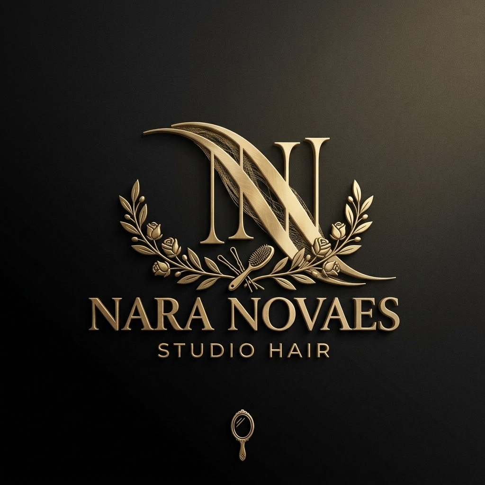

# ✨ Nara Novaes Studio Hair | Website Oficial

<p align="center">
  
</p>

<p align="center">
  <strong>Transformação, Beleza e Cuidado Personalizado em São Paulo</strong>
</p>

<p align="center">
  
  
  
  
  
</p>

---

## 📌 Sobre o Projeto

O **Nara Novaes Studio Hair** é um website institucional e de conversão desenvolvido com foco em alta performance, design sofisticado (Paleta *Rose Gold & Warm Champagne*), responsividade fluida e otimização para motores de busca (SEO Local e Estruturado).

O salão é especializado em técnicas exclusivas como **Morena Iluminada**, valorização de **Cabelos Grisalhos**, **Alisamentos/Progressivas** e **Nail Art**, proporcionando uma experiência acolhedora e com nota máxima de avaliação no Google.

---

## 🌟 Funcionalidades e Destaques

- **✨ Design Moderno & Premium**: Layout com estética contemporânea, tipografia refinada (*Cormorant Garamond* e *Plus Jakarta Sans*) e paleta elegante.
- **📱 100% Responsivo & Mobile-First**: Perfeita visualização e usabilidade em smartphones, tablets, notebooks e desktops.
- **⚡ Alta Performance**: Desenvolvido em Vanilla HTML5, CSS3 e JavaScript puro, sem dependências pesadas, garantindo carregamento ultrarrápido.
- **💬 Conversão Direta para WhatsApp**: Botões de agendamento estratégicos com mensagens personalizadas pré-definidas para cada serviço.
- **🔍 SEO Avançado & Rich Snippets**:
  - Schema.org estruturado em JSON-LD (`BeautySalon`).
  - Open Graph e Meta Tags configurados para compartilhamento em redes sociais.
- **🎨 Efeitos & Microinterações**:
  - Scroll Reveal Animations suaves.
  - Galeria de transformações com antes/depois e visualização detalhada.
  - FAQ interativo em acordeão.
  - Carrossel de avaliações e depoimentos de clientes.
  - Modo Noturno / Efeitos de iluminação sutil.

---

## 🛠️ Tecnologias Utilizadas

- **HTML5 Semântico**: Estrutura acessível e otimizada para buscadores.
- **CSS3 Moderno**: CSS Custom Properties (Variáveis), CSS Grid, Flexbox e animações por GPU.
- **JavaScript (ES6+)**: Lógica dinâmica, controle de menu responsivo, accordion interativo e animações de rolagem.
- **Font Awesome 6**: Ícones vetoriais leves para interface.
- **Google Fonts**: Tipografias elegantes e balanceadas.

---

## 📂 Estrutura de Pastas

```bash
salao-de-beleza/
├── assets/
│   └── images/              # Imagens dos serviços, fotos do studio e logotipos
├── css/
│   └── style.css            # Folha de estilos completa e modularizada
├── js/
│   └── main.js              # Interações, animações e lógica do site
├── .docs/                   # Especificações e materiais de apoio
├── .gitignore               # Arquivos e pastas ignorados pelo Git
├── index.html               # Página principal do site
└── README.md                # Documentação oficial do projeto
```

---

## 🚀 Como Executar Localmente

Como o projeto é construído exclusivamente com tecnologias web padrão (HTML/CSS/JS estático), não é necessária nenhuma instalação complexa ou banco de dados:

1. **Clone o repositório:**
   ```bash
   git clone https://github.com/larissamoreira001/salao-de-beleza.git
   ```

2. **Navegue até a pasta do projeto:**
   ```bash
   cd salao-de-beleza
   ```

3. **Abra o projeto:**
   - Dê um duplo clique no arquivo `index.html`, **OU**
   - Use a extensão **Live Server** no VS Code, **OU**
   - Execute com qualquer servidor estático local:
     ```bash
     npx serve .
     ```

---

## 📍 Localização & Contato

- **Studio**: Nara Novaes Studio Hair
- **Endereço**: R. Anhandui Mirim - Jardim das Flores, São Paulo - SP, 04904-200
- **WhatsApp**: +55 (11) 95397-8759
- **Horário de Atendimento**: Terça a Sábado das 09:00 às 19:00

---

## 👩‍💻 Autoria & Créditos

Desenvolvido com excelência para o **Nara Novaes Studio Hair**.  
Repositório mantido por [@larissamoreira001](https://github.com/larissamoreira001).
